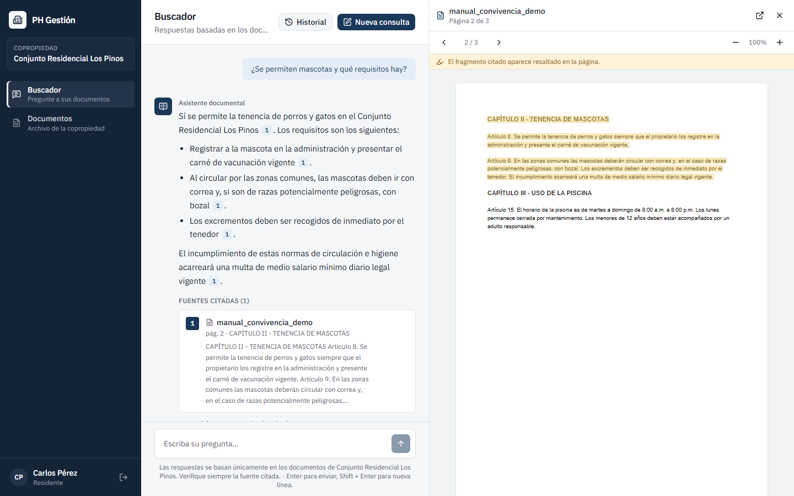
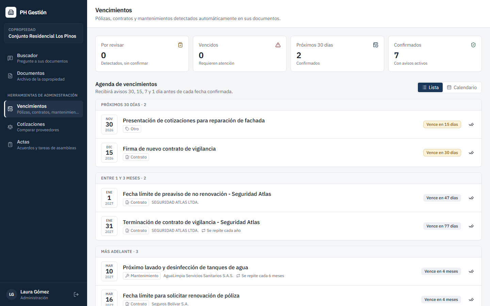
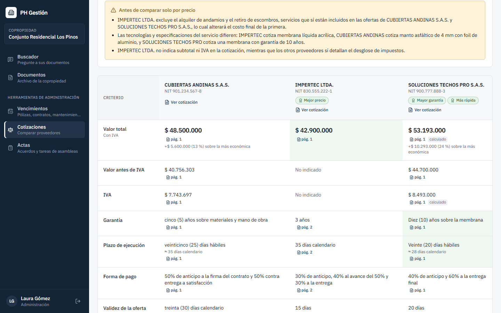
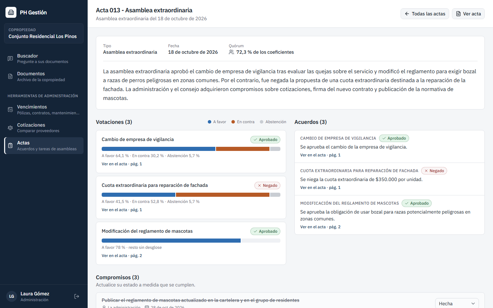
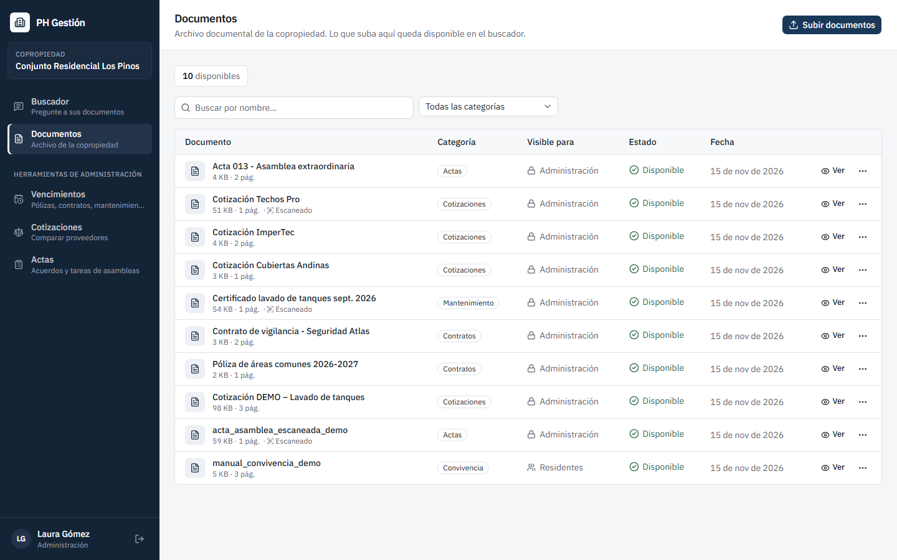
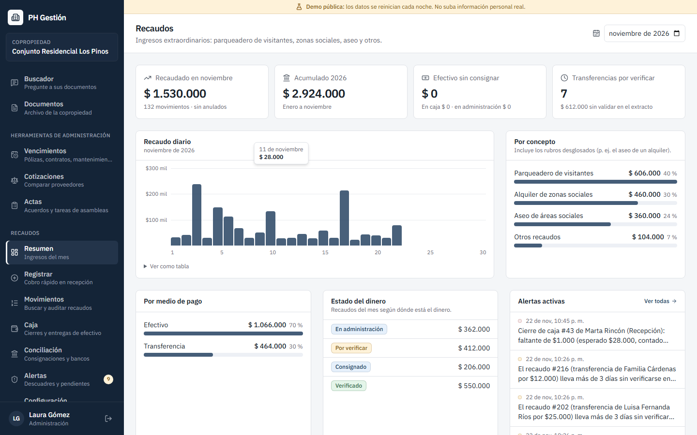
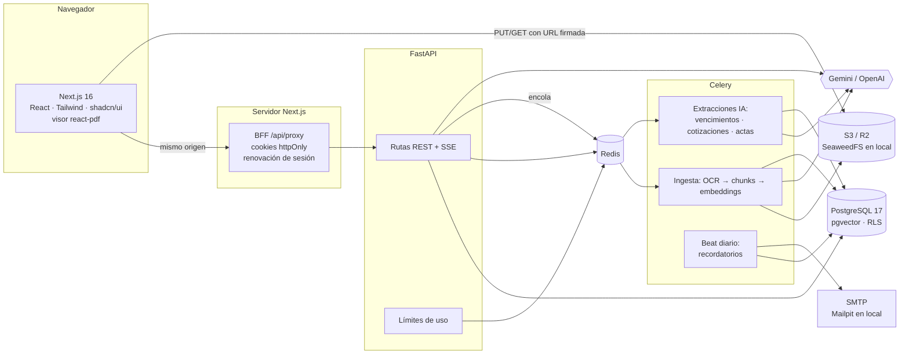
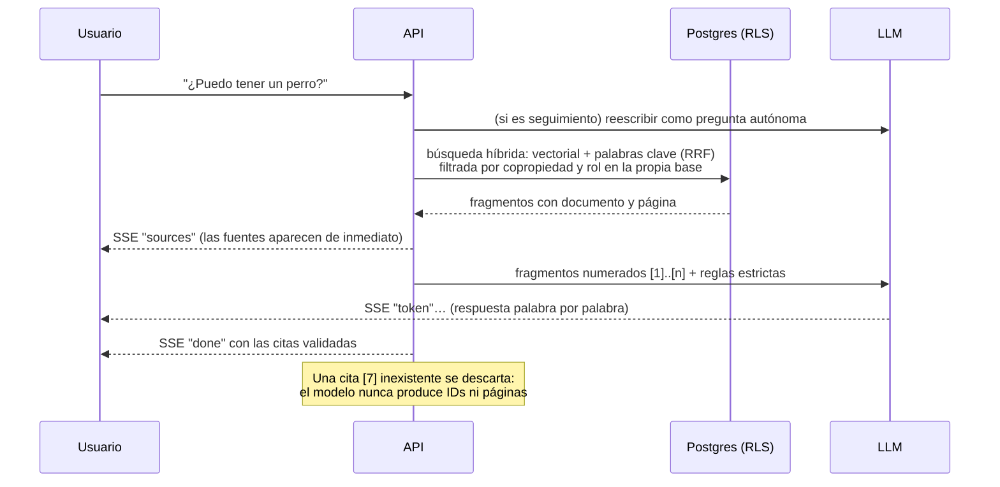

# PH Gestión

[](https://github.com/Nanielitow/Propiedad-horizontal/actions/workflows/ci.yml)


**Gestión documental con IA para edificios y conjuntos residenciales (propiedad horizontal).**

Una plataforma SaaS multi-copropiedad donde la administración sube sus documentos (reglamentos, actas, contratos, pólizas, cotizaciones, incluso escaneados) y obtiene:

- un **buscador que responde preguntas** citando el documento y la **página exacta**, que se abre resaltada en un visor PDF;
- **vencimientos detectados automáticamente** (pólizas, contratos, mantenimientos) con calendario y recordatorios por correo;
- **comparación de cotizaciones** con tabla de precios, garantías y plazos, más un análisis para el consejo;
- **resúmenes de actas** con acuerdos, votaciones y compromisos con seguimiento.
- **control de recaudos** (parqueadero de visitantes, alquiler de zonas sociales, aseo): caja por turno, conciliación bancaria, auditoría inmutable y reportes en Excel y PDF.



> El principio que guía todo el proyecto: **la IA propone, el código verifica.** Ninguna cifra, fecha o cita llega a la pantalla sin comprobarse antes contra el texto del documento.

---

## Contenido

- [Módulos](#módulos)
- [Pruébalo en 5 minutos](#pruébalo-en-5-minutos)
- [Arquitectura](#arquitectura)
- [Cómo funciona el buscador (RAG)](#cómo-funciona-el-buscador-rag)
- [La IA propone, el código verifica](#la-ia-propone-el-código-verifica)
- [Seguridad](#seguridad)
- [Stack](#stack)
- [Calidad y pruebas](#calidad-y-pruebas)
- [Costos de operación](#costos-de-operación)
- [Estructura del repositorio](#estructura-del-repositorio)
- [Limitaciones y próximos pasos](#limitaciones-y-próximos-pasos)

---

## Módulos

| Módulo | Para quién | Qué hace |
|---|---|---|
| **Buscador** | Residentes y administración | Preguntas en lenguaje natural con respuesta en *streaming*. Cada afirmación lleva una cita `[n]`; al pulsarla se abre el PDF en esa página con el fragmento resaltado. Cada rol solo consulta lo que puede ver. |
| **Documentos** | Administración (residentes: solo lectura) | Subida directa a almacenamiento S3, OCR automático de escaneados, progreso de procesamiento en vivo y control de visibilidad (residentes o solo administración). |
| **Vencimientos** | Administración | Detecta fechas en pólizas, contratos, actas y certificados, incluidas las **calculadas** ("12 meses desde el 1 de febrero", "preaviso de 30 días"). Quedan pendientes de revisión, con la frase de origen. Incluye agenda en lista o calendario, recurrencias y recordatorios 30/15/7/1 días antes. |
| **Cotizaciones** | Administración | Compara de 2 a 4 propuestas: total con IVA, garantía, plazo, forma de pago y alcance. Marca el mejor de cada criterio y redacta un análisis que **advierte cuando el precio más bajo engaña** (por ejemplo, si no incluye andamios). |
| **Actas** | Administración | Resume la reunión: quórum, acuerdos, votaciones con porcentajes y compromisos con responsable y fecha, que se siguen hasta cerrarlos. |
| **Recaudos** | Administración, recepción, contabilidad y consejo | Ingresos extraordinarios con su ciclo completo: registro rápido (tarifa de parqueadero por tiempo, alquiler con reserva desglosado en alquiler + aseo), cierre de caja con diferencias justificadas, entregas internas, consignaciones parciales, verificación contra el extracto, alertas de auditoría, dashboard y reportes. **Nada se borra:** los errores se anulan con motivo y todo queda en una auditoría que escribe la propia base de datos. Diseño en [docs/RECAUDOS.md](docs/RECAUDOS.md). |

<table>
  <tr>
    <td></td>
    <td></td>
  </tr>
  <tr>
    <td></td>
    <td></td>
  </tr>
</table>



---

## Pruébalo en 5 minutos

**Requisitos:** Docker Desktop y Node.js 22 o superior. La IA requiere una API key de [Google AI Studio](https://aistudio.google.com/) (Gemini) u OpenAI. Sin key, el sistema funciona con embeddings locales de prueba (`EMBEDDING_PROVIDER=fake`), pero sin respuestas generadas.

```bash
cp .env.example .env            # y añade GEMINI_API_KEY u OPENAI_API_KEY
npm run setup                   # levanta los servicios, aplica migraciones y crea los datos demo
npm run samples                 # genera PDFs de ejemplo en apps/api/samples
docker compose exec api python -m app.scripts.demo recaudos   # ~6 semanas de movimientos de recaudos
docker compose exec api python -m app.scripts.demo activos    # un año de historial de mantenimiento
npm run web:install && npm run web:dev
```

| Dirección | Qué es |
|---|---|
| http://localhost:3000 | La aplicación (botones de **cuentas demo** en el login) |
| http://localhost:8000/docs | Documentación interactiva de la API |
| http://localhost:8025 | Bandeja de correo de desarrollo (Mailpit): aquí llegan los recordatorios |

**Cuentas demo** (contraseña `Demo1234!`):

| Usuario | Rol | Copropiedad |
|---|---|---|
| `admin@lospinos.demo` | Administración | Conjunto Residencial Los Pinos |
| `residente@lospinos.demo` | Residente | Conjunto Residencial Los Pinos |
| `recepcion@lospinos.demo` | Recepción (registra recaudos y cierra su caja) | Conjunto Residencial Los Pinos |
| `contabilidad@lospinos.demo` | Contabilidad (verifica y concilia) | Conjunto Residencial Los Pinos |
| `consejo@lospinos.demo` | Consejo (dashboard y cortes mensuales) | Conjunto Residencial Los Pinos |
| `tecnico@lospinos.demo` | Técnico de mantenimiento (consulta por QR, reporta fallas y registra trabajos) | Conjunto Residencial Los Pinos |
| `admin@torrecentral.demo` | Administración | Edificio Torre Central (para probar el aislamiento) |

Atajos útiles: `npm run test`, `npm run logs`, `npm run db:psql`, `npm run reset`.

---

## Producción

La aplicación se despliega en **un VPS con Docker** (unos 5–7 USD al mes):

- **Caddy** sirve la app por HTTPS con certificado automático y es lo único expuesto a internet. La API, Postgres y Redis viven en la red interna.
- **GitHub Actions** publica las imágenes en GHCR y despliega por SSH en cada *push* a `main` que pasa el CI.
- **Cloudflare R2** guarda los archivos y las copias diarias de la base de datos; **Resend** envía los correos.
- **Modo demo pública:** límites por visitante, aviso visible y **restauración nocturna** de los datos desde una instantánea, en menos de un segundo y sin llamadas a la IA.

Guía completa, desde comprar el dominio hasta pasar a uso real: **[docs/DEPLOY.md](docs/DEPLOY.md)**.

---

## Arquitectura



- **Monorepo** con `apps/web` (Next.js) y `apps/api` (FastAPI; el mismo código corre la API y los workers de Celery).
- **Los archivos no pasan por la API.** El navegador los sube directo al almacenamiento con una URL firmada de 5 minutos, y el visor los descarga igual.
- **El trabajo pesado es asíncrono.** El OCR, los embeddings y las extracciones con IA corren en workers con reintentos y *backoff*. Los errores permanentes (PDF cifrado) se distinguen de los transitorios (red, cuota de la IA).
- **Docker Compose** levanta todo en local: Postgres con pgvector, Redis, SeaweedFS, Mailpit, la API, el worker y beat.

---

## Cómo funciona el buscador (RAG)



- **Chunks por página y sección.** Se abre un fragmento nuevo en cada capítulo, así que cada cita apunta a la página correcta.
- **Búsqueda híbrida.** Los vectores entienden el sentido ("perro" encuentra "mascotas") y las palabras clave atrapan literales (números de póliza, "Artículo 23"). Ambos rankings se combinan con *Reciprocal Rank Fusion*.
- **Sin fragmentos no se llama al LLM:** costo cero y ninguna posibilidad de inventar.
- **Defensa contra inyección de prompts:** el contenido de los documentos se trata como dato y no como instrucciones, y se neutralizan las etiquetas.

---

## La IA propone, el código verifica

La IA es buena extrayendo y redactando, pero puede equivocarse con seguridad. Cada módulo tiene verificaciones deterministas antes de mostrar o guardar algo:

| Dato propuesto por la IA | Verificación en código | Si falla |
|---|---|---|
| Cita `[n]` en una respuesta | `n` debe ser un fragmento recuperado | Se descarta |
| Fecha de vencimiento | La frase de origen debe estar **literalmente** en el documento (o ≥ 85 % de sus palabras, para tolerar OCR); la página se corrige si hace falta | Se descarta (alucinación) |
| Monto de una cotización | La cifra debe aparecer escrita (formatos `48.500.000`, `48,500,000` o `48500000`). Un total o IVA calculado se comprueba con la aritmética y la tasa citada | Se marca **"verificar"** |
| Mejor precio, garantía o plazo | Lo calcula el código, no el LLM (los días hábiles se convierten a calendario) | — |
| Porcentajes de una votación o el quórum | Deben aparecer escritos en el acta | "verificar" (o no se muestra) |
| Cualquier vencimiento | Queda **pendiente de revisión humana** hasta que un admin lo confirma | No genera alertas |

Además, en el análisis de cotizaciones los datos **ausentes** se envían al modelo como "no indicado" y no como "no verificado", para no crear falsas alarmas.

---

## Seguridad

**Aislamiento multi-copropiedad en tres capas.** Si una falla, las otras contienen el error:

1. **Filtros explícitos** por `tenant_id` en cada consulta.
2. **Row Level Security de PostgreSQL** con `FORCE`. La API se conecta con un rol sin privilegios, y un listener re-aplica `SET LOCAL app.tenant_id / role` en cada transacción. Sin contexto, la base devuelve cero filas. Incluso la función de búsqueda vectorial respeta RLS: está probado que, aunque se le pida otro edificio, no devuelve nada.
3. **Claves foráneas compuestas** `(tenant_id, id)`, que hacen imposible relacionar datos de dos edificios.

**Roles.** Un residente solo ve documentos públicos. Esto también lo hace cumplir la base de datos con políticas `RESTRICTIVE`, de modo que un bug en la API no lo saltaría.

**Sesión:**
- El JWT nunca llega al JavaScript del navegador: un BFF en Next.js lo guarda en **cookies httpOnly**.
- El acceso dura 15 minutos y se renueva con un *refresh token* de 7 días que **rota en cada uso** y se revoca al cerrar sesión.
- Una **ventana de gracia de 30 s** evita cerrar la sesión cuando varias peticiones simultáneas intentan renovar a la vez.

**Abuso y costos:**
- Límites por usuario (preguntas por minuto y por día, subidas por hora).
- Límite por edificio para los análisis con IA.
- Límite de intentos de login por cuenta y por red, contra fuerza bruta.

**Otros:**
- Auditoría *append-only*: los residentes registran sus accesos, solo el admin los lee y nadie los borra.
- URLs firmadas de corta duración.
- Verificación de tipo real (`%PDF-`) y de `sha256` en cada archivo.
- Cabeceras de seguridad HTTP.
- La API se niega a arrancar en producción con secretos de ejemplo.

---

## Stack

| Capa | Tecnologías |
|---|---|
| Frontend | Next.js 16 (App Router), TypeScript estricto, Tailwind CSS 4, shadcn/ui, SWR, react-pdf |
| Backend | Python 3.12, FastAPI, SQLAlchemy 2 (async), Alembic, Pydantic v2 |
| Asíncrono | Celery + Redis (colas separadas para ingesta y para IA; beat para tareas diarias) |
| Datos | PostgreSQL 17 + pgvector 0.8 (HNSW con *iterative scan*), búsqueda de texto completo en español |
| Documentos | PyMuPDF, ocrmypdf + Tesseract (español) |
| IA | Gemini (chat `3.5-flash-lite`, extracción `3.5-flash`, `gemini-embedding-001`) u OpenAI, intercambiables. *Structured Outputs* con esquemas Pydantic y respaldo automático si se agota la cuota |
| Infraestructura | Docker Compose, SeaweedFS (S3 local; Cloudflare R2 en producción), Mailpit, GitHub Actions |

---

## Calidad y pruebas

```bash
npm run test        # 65 tests de backend
```

- **Unitarios:** chunking, prompt y citas, verificación de fechas, montos (formatos, IVA calculado) y actas, elección del mejor por criterio, límite de solicitudes y respaldo de modelo.
- **Integración contra Postgres real:** aislamiento entre edificios, roles, claves foráneas compuestas, propagación de permisos, búsqueda híbrida con RLS y auditoría *append-only* (incluida una regresión: `INSERT … RETURNING` bajo RLS).
- **Pruebas de punta a punta** de cada módulo con documentos reales (incluidos escaneados) y recorridos de la interfaz con Playwright.
- **CI** (`.github/workflows/ci.yml`): lint y formato (ruff), migraciones y tests contra pgvector, typecheck y build del frontend, y build de las imágenes Docker de producción.

---

## Costos de operación

Son estimaciones con los precios publicados de Gemini (noviembre de 2026) y los tokens medidos en las pruebas:

| Acción | Costo aproximado (USD) |
|---|---|
| Una pregunta en el buscador | $0,0005 |
| Detectar vencimientos o resumir un acta | $0,01 – $0,04 |
| Comparar 3 cotizaciones | $0,05 – $0,10 |
| **Un edificio típico al mes** | **< $1** |

Decisiones que lo mantienen bajo:
- Modelo *Lite* con razonamiento mínimo para el chat (también responde en unos 0,7 s).
- Sin fragmentos relevantes, no se llama al LLM.
- Límites de uso por usuario y por edificio.

En producción con datos reales debe usarse el **plan pago** de la API: en el plan gratuito, Google puede usar el contenido enviado para mejorar sus productos.

---

## Estructura del repositorio

```
apps/
  api/                 FastAPI + Celery
    alembic/sql/       Migraciones SQL-first (RLS, políticas, triggers, búsqueda híbrida)
    app/api/v1/        Rutas: auth, documents, search, deadlines, quotes, minutes, recaudos
    app/services/      ingestion · retrieval · extraction · llm · storage · notifications · recaudos
    app/workers/       Tareas de Celery y programación diaria
    tests/             Unitarios e integración (RLS)
  web/                 Next.js
    src/app/api/       BFF: login, logout, renovación y proxy hacia la API
    src/components/    chat · documents · deadlines · quotes · minutes · recaudos · pdf-viewer · layout
infra/                 Inicialización de Postgres y configuración de SeaweedFS
deploy/                Caddyfile y scripts del servidor: preparación, secretos, despliegue, copias
docs/                  ARCHITECTURE.md (40+ decisiones de diseño), RECAUDOS.md, DEPLOY.md y capturas
docker-compose.yml     Entorno local completo
docker-compose.prod.yml  Producción: imágenes de GHCR, Caddy + HTTPS, solo los puertos 80/443
```

La explicación de cada decisión de diseño, con sus pros y contras, está en **[docs/ARCHITECTURE.md](docs/ARCHITECTURE.md)**.

---

## Limitaciones y próximos pasos

- **Alta de usuarios e invitaciones:** hoy los usuarios se crean con el script de datos demo; falta el flujo de invitación por correo.
- **Gestión de unidades y residentes** (apartamentos, coeficientes) desde la interfaz.
- **API por lotes (Batch) de Gemini** para las extracciones no urgentes, con un 50 % de ahorro.
- **Evaluación sistemática del RAG:** cada respuesta ya guarda su traza (fragmentos, puntuaciones, pregunta reescrita) para construir un conjunto de evaluación.
- **Observabilidad:** métricas y trazas (OpenTelemetry) de la latencia de la IA y de las colas.

## Licencias

Código del proyecto con fines de portafolio. Atención: **PyMuPDF** y **Ghostscript** (que usa ocrmypdf) tienen licencia AGPL. Para un SaaS de código cerrado habría que comprar su licencia comercial o reemplazarlos (por ejemplo, por `pypdfium2`).
