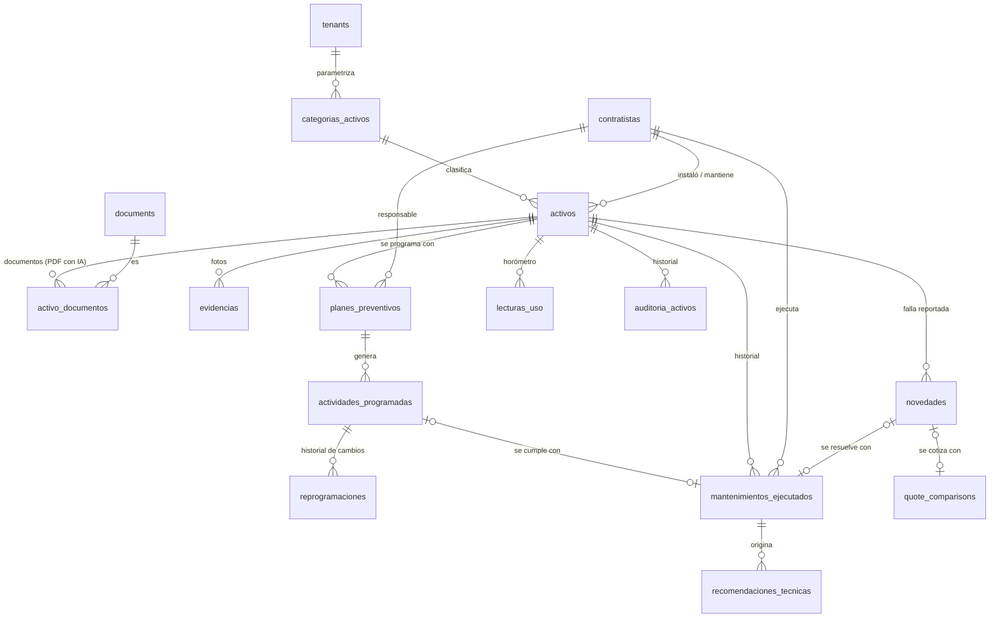
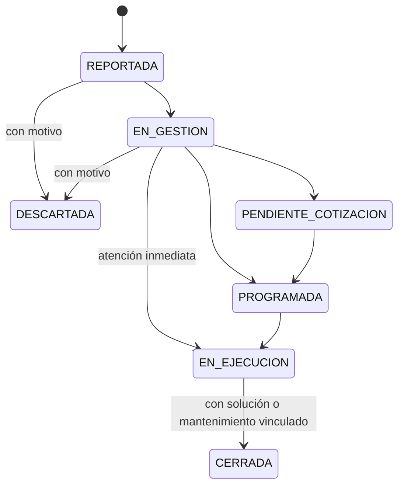

# Módulo de Activos, Hojas de Vida y Plan de Mantenimiento (CMMS)

Diseño del segundo gran módulo: la **hoja de vida técnica** de equipos e infraestructura, el **plan de mantenimiento preventivo** con semáforo, las **novedades y correctivos**, los **contratistas**, las **recomendaciones técnicas** y la **proyección de costos**. El objetivo es pasar de una administración reactiva a una preventiva.

Estado: **fase 1 implementada** (base de datos y lógica). Ver §7.

---

## 0. Cómo encaja en la plataforma

El módulo reutiliza lo que ya existe en lugar de duplicarlo:

| Ya existe | Cómo lo usa el módulo |
|---|---|
| Multi-tenant con RLS, FK compuestas `(tenant_id, id)` y roles en `memberships` | Todas las tablas nuevas lo siguen. Se agrega el rol **`MANTENIMIENTO`** (todero o técnico interno) |
| **Documentos** con OCR y buscador con IA | Los manuales, planos, garantías y contratos de un activo **son documentos de la plataforma** vinculados al activo. Quedan buscables con IA ("¿cada cuánto se cambia el aceite de la motobomba?") y se abren en el visor con citas. No se crea un segundo repositorio de PDF |
| **Vencimientos** (detectados por IA en contratos y pólizas) | Al vincular un contrato o una garantía a un activo, sus vencimientos aparecen en la hoja de vida. El calendario de vencimientos muestra también las actividades preventivas |
| **Comparador de cotizaciones** | Una novedad en `PENDIENTE_COTIZACION` se vincula a una comparación de cotizaciones existente |
| Infraestructura del módulo de recaudos | Mismos patrones: auditoría escrita por trigger, inmutabilidad, consecutivos sin huecos, máquinas de estado en la base, alertas por correo tras el commit y motor de reportes Excel/PDF (se generaliza para ambos módulos) |

**Sobre "terceros y proveedores ya existentes":** hoy la plataforma solo guarda nombres de proveedor como texto, en vencimientos y cotizaciones. Este módulo crea la tabla **`contratistas`** como registro maestro de proveedores. Las cotizaciones y los vencimientos podrán enlazarse a ella más adelante sin romper nada.

**Decisiones de adaptación:**

1. **Fotos y evidencias en una tabla propia (`evidencias`).** El módulo de documentos solo admite PDF y los pasa por OCR. Las fotos (antes y después, fallas, activo) van como imágenes en el almacenamiento, en una tabla polimórfica reutilizable por activos, mantenimientos y novedades.
2. **El QR no contiene datos, solo un enlace con un token aleatorio** (`/{copropiedad}/activos/qr/{token}`). Quien lo escanea **debe iniciar sesión**, y lo que ve depende de su rol (RLS). Un QR fotografiado en un sótano no expone nada.
3. **Plan y actividades separados.** El plan es la regla ("motobomba: mensual"). Las **actividades programadas** son cada ocurrencia con su fecha. Así existen el calendario, el cronograma anual, el KPI "programado vs. ejecutado" y la trazabilidad de reprogramaciones, que no son posibles calculando solo "la próxima fecha".
4. **El semáforo se calcula al consultar, no se guarda.** Un color almacenado se desactualiza a medianoche. Se calcula en SQL con la fecha de Bogotá; el cron diario solo genera alertas y extiende el horizonte de programación.
5. **Nada se borra.** Los activos se dan de baja (`DADO_DE_BAJA`) y los mantenimientos ejecutados se anulan con motivo. Todo queda en la auditoría.

---

## 1. Modelo entidad-relación

### 1.1 Catálogos

**`categorias_activos`**: tabla maestra extensible, con jerarquía de dos niveles (categoría → subtipo).

| Campo | Tipo | Notas |
|---|---|---|
| id, tenant_id | uuid | |
| codigo | text | `ELECTROMECANICOS`, `SEGURIDAD_TECNOLOGIA`, `REDES_INSTALACIONES`, `INFRAESTRUCTURA`. Único por tenant |
| nombre, descripcion | text | |
| subtipos | text[] | Sugerencias para el formulario: `{Ascensor, Motobomba, Planta eléctrica, …}` |
| es_infraestructura | bool | Alimenta el *Informe de Infraestructura* (fachadas, cubiertas, impermeabilizaciones, tanques) |
| activo | bool | |

Se siembran las 4 categorías del requerimiento con sus subtipos.

**`contratistas`**: registro maestro de proveedores.

| Campo | Tipo | Notas |
|---|---|---|
| id, tenant_id | uuid | |
| razon_social, nit | text | NIT único por tenant |
| contacto_nombre, telefono, email | text | |
| especialidades | text[] | Ascensores, bombas, CCTV… |
| vigencia_contrato_inicio, vigencia_contrato_fin | date NULL | |
| alcance_contrato, periodicidad_pactada | text | |
| valor_contrato | numeric(14,2) NULL | Valor anual; entra en la proyección presupuestal |
| contrato_documento_id | uuid FK → documents NULL | El contrato es un documento de la plataforma (OCR, IA, vencimientos) |
| calificacion_cumplimiento | numeric(3,2) **calculada** | Vista: % de actividades ejecutadas a tiempo y tiempo de respuesta a novedades. No se escribe a mano |
| activo | bool | |

### 1.2 Hoja de vida del activo

**`activos`**

| Campo | Tipo | Notas |
|---|---|---|
| id, tenant_id | uuid | |
| codigo_interno | text | `ACT-001`, **consecutivo sin huecos** por tenant (como los recibos de recaudos) |
| qr_token | text | 32 caracteres aleatorios, único global. Se puede **regenerar** si una etiqueta se pierde (el anterior deja de funcionar) |
| nombre | text | |
| categoria_id | uuid FK | |
| subtipo | text | |
| ubicacion | text | "Torre 1 · Sótano 2" |
| marca, modelo, fabricante, numero_serie | text NULL | |
| especificaciones | jsonb | Clave/valor flexible: `{"Capacidad": "8 personas", "Potencia": "15 HP"}` |
| vida_util_anios | int NULL | Con la fecha de instalación da el **% de vida útil consumida** |
| fecha_instalacion | date NULL | |
| instalador_id | uuid FK → contratistas NULL | |
| mantenedor_id | uuid FK → contratistas NULL | Contratista responsable actual |
| fecha_vencimiento_garantia | date NULL | Alerta 30 días antes |
| criticidad | enum `ALTA`, `MEDIA`, `BAJA` | "Activos críticos" del dashboard (ascensores, bombas, planta, red contra incendios) |
| estado | enum `OPERATIVO`, `OPERATIVO_CON_OBSERVACIONES`, `EN_MANTENIMIENTO`, `FUERA_DE_SERVICIO`, `DADO_DE_BAJA` | `DADO_DE_BAJA` reemplaza al borrado: exige motivo y es final |
| motivo_baja, fecha_baja | | Obligatorios si está dado de baja (CHECK) |
| created_at, updated_at | timestamptz | |

**`activo_documentos`**: vínculo con los documentos de la plataforma.

| Campo | Tipo |
|---|---|
| activo_id, document_id | uuid (PK compuesta) |
| tipo | enum `MANUAL`, `PLANO`, `FICHA_TECNICA`, `GARANTIA`, `CONTRATO`, `ACTA`, `CERTIFICACION`, `FACTURA`, `INFORME_TECNICO`, `OTRO` |
| fecha_documento | date NULL |
| vinculado_por_id, created_at | |

**`evidencias`**: fotos y archivos que no son documentos con IA.

| Campo | Tipo | Notas |
|---|---|---|
| id, tenant_id | uuid | |
| entidad | enum `ACTIVO`, `MANTENIMIENTO`, `NOVEDAD` | |
| entidad_id | uuid | |
| momento | enum `ANTES`, `DESPUES`, `EVIDENCIA`, `FOTO_ACTIVO`, `INFORME`, `FACTURA` | Fotos antes y después del requerimiento |
| storage_key | text | `tenants/{t}/activos/evidencias/{uuid}.{ext}`, validado como los soportes de recaudos |
| content_type, size_bytes | | JPG, PNG, WEBP o PDF |
| subido_por_id, created_at | | Inmutable: no se edita ni se borra |

**`lecturas_uso`**: horómetro, para los planes `POR_HORAS_USO`.

| Campo | Tipo |
|---|---|
| id, tenant_id, activo_id | uuid |
| fecha | timestamptz |
| horas_acumuladas | numeric(10,1) (debe ser ≥ la lectura anterior: trigger) |
| registrado_por_id | uuid |

### 1.3 Plan preventivo y actividades

**`planes_preventivos`**: la regla.

| Campo | Tipo | Notas |
|---|---|---|
| id, tenant_id, activo_id | uuid | |
| nombre | text | "Mantenimiento mensual de motobombas" |
| actividades_checklist | text[] | Lo que el técnico debe hacer y marcar |
| periodicidad | enum `SEMANAL`, `QUINCENAL`, `MENSUAL`, `BIMESTRAL`, `TRIMESTRAL`, `SEMESTRAL`, `ANUAL`, `POR_HORAS_USO` | |
| intervalo_horas | int NULL | Obligatorio si es por horas de uso |
| base_calculo | enum `CALENDARIO_FIJO`, `DESDE_ULTIMA_EJECUCION` | Fijo: siempre el día 5 de cada mes. Desde ejecución: un mes después de la última vez que se hizo |
| fecha_inicio | date | |
| contratista_id | uuid FK NULL | Responsable |
| costo_estimado | numeric(14,2) NULL | Por ejecución; alimenta el plan anual y la proyección |
| aprobado_por_id, aprobado_at | | El administrador **aprueba** el plan: solo los aprobados generan actividades |
| activo | bool | Pausar un plan cancela sus actividades futuras sin borrarlas |

**`actividades_programadas`**: cada ocurrencia.

| Campo | Tipo | Notas |
|---|---|---|
| id, tenant_id, plan_id, activo_id | uuid | |
| fecha_programada | date | La vigente |
| fecha_original | date | La primera que tuvo; nunca cambia |
| estado | enum `PROGRAMADA`, `EJECUTADA`, `CANCELADA` | "Vencida" no se guarda: se calcula (semáforo rojo) |
| mantenimiento_id | uuid FK NULL | El mantenimiento que la cumplió |
| asignado_a_id | uuid FK → users NULL | Técnico interno (rol Mantenimiento) |
| UNIQUE | (plan_id, fecha_original) | El cron puede correr dos veces sin duplicar |

**`reprogramaciones`**: el historial que pide el requerimiento. Cambiar la fecha **sin registro es imposible**: un trigger rechaza cualquier `UPDATE` de `fecha_programada` que no venga acompañado de una fila aquí, en la misma transacción.

| Campo | Tipo |
|---|---|
| id, tenant_id, actividad_id | uuid |
| fecha_anterior, nueva_fecha | date |
| motivo | text (mínimo 10 caracteres, CHECK) |
| usuario_id, created_at | |

### 1.4 Historial de intervenciones

**`mantenimientos_ejecutados`**: inmutable. No se borra ni se editan sus datos técnicos o de costo; un error se corrige **anulando** (motivo, auditoría) y registrando de nuevo.

| Campo | Tipo | Notas |
|---|---|---|
| id, tenant_id, activo_id | uuid | |
| consecutivo | bigint | `MTO-0001` por tenant |
| tipo | enum `PREVENTIVO`, `CORRECTIVO`, `PREDICTIVO`, `INSPECCION_TECNICA` | |
| fecha_ejecucion | date | No futura |
| contratista_id | uuid FK NULL | NULL = personal interno |
| nombre_tecnico | text | |
| tiempo_ejecucion_horas | numeric(6,2) NULL | |
| diagnostico_inicial, actividades_realizadas, repuestos_utilizados, novedades_encontradas, recomendaciones_tecnico | text | `recomendaciones_tecnico` es el texto libre; cada recomendación accionable se crea además como fila en `recomendaciones_tecnicas` |
| checklist | jsonb | Las actividades del plan marcadas (hecho / no aplica / pendiente) |
| estado_post_intervencion | enum de estado del activo | **Actualiza el estado del activo** (trigger) |
| costo_mano_obra, costo_repuestos | numeric(14,2) ≥ 0 | |
| costo_total | numeric(14,2) **generada** | mano de obra + repuestos |
| fecha_proximo_recomendado | date NULL | Si el plan es `DESDE_ULTIMA_EJECUCION`, define la siguiente actividad |
| actividad_id | uuid FK NULL | La actividad preventiva que cumple (la marca `EJECUTADA`) |
| novedad_id | uuid FK NULL | El correctivo que resuelve |
| informe_documento_id, factura_documento_id | uuid FK → documents NULL | Informe y factura como documentos de la plataforma (OCR, IA) |
| registrado_por_id, created_at | | |
| anulado_por_id, anulado_at, motivo_anulacion | | |

Las fotos de antes y después son `evidencias` con `entidad = MANTENIMIENTO`.

### 1.5 Novedades y recomendaciones

**`novedades`**: tickets de falla.

| Campo | Tipo | Notas |
|---|---|---|
| id, tenant_id, activo_id | uuid | |
| consecutivo | bigint | `NOV-0001` |
| fecha_reporte | timestamptz | |
| reportado_por_id | uuid FK | Cualquier rol operativo, incluido Mantenimiento desde el QR |
| descripcion, riesgo_identificado | text | |
| prioridad | enum `BAJA`, `MEDIA`, `ALTA`, `CRITICA` | `CRITICA` notifica de inmediato y sugiere poner el activo fuera de servicio |
| estado | enum (ver diagrama) | |
| contratista_asignado_id | uuid FK NULL | |
| cotizacion_id | uuid FK → quote_comparisons NULL | |
| fecha_atencion | timestamptz NULL | Primera atención: mide el **tiempo de respuesta** |
| diagnostico, solucion_implementada | text NULL | |
| costo_reparacion | numeric(14,2) NULL | Si hay mantenimiento vinculado, sale de su costo total |
| mantenimiento_id | uuid FK NULL | |
| cerrada_por_id, cerrada_at | | **Solo el administrador cierra** |
| motivo_descarte | text NULL | Para `DESCARTADA` (reporte duplicado o sin falla real) |

Se agregó **`DESCARTADA`** al flujo del requerimiento: sin ella, un reporte duplicado o una falsa alarma quedaría abierto para siempre o habría que borrarlo.

**`recomendaciones_tecnicas`**: cada sugerencia del técnico, convertida en tarea.

| Campo | Tipo | Notas |
|---|---|---|
| id, tenant_id, activo_id | uuid | |
| mantenimiento_origen_id | uuid FK NULL | NULL si viene de una inspección o de la administración |
| descripcion | text | |
| prioridad | enum `ALTA`, `MEDIA`, `BAJA` | |
| responsable_id | uuid FK → users NULL | |
| fecha_limite | date NULL | Vencida y pendiente genera alerta |
| costo_estimado | numeric(14,2) NULL | **Entra en la proyección presupuestal** |
| observaciones_administracion | text NULL | |
| estado | enum `PENDIENTE`, `EN_PROCESO`, `EJECUTADA`, `DESCARTADA_CON_JUSTIFICACION` | Descartar exige justificación (CHECK); ejecutar puede vincular el mantenimiento que la cumplió |

### 1.6 Auditoría y alertas

- **`auditoria_activos`**: escrita **por trigger** (SECURITY DEFINER), igual que `auditoria_recaudos`. Guarda usuario, fecha y hora, acción y solo los campos que cambiaron (JSON antes/después), con motivo. Cubre activos, planes, actividades, mantenimientos, novedades, recomendaciones y contratistas. Nadie puede editarla ni borrarla.
- **`notificaciones_mantenimiento`**: registro de avisos enviados, con clave única `(tipo, entidad_id, fecha_aviso)`, para que el cron nunca envíe un aviso dos veces (mismo patrón que los recordatorios de vencimientos).

---

## 2. Semáforo y alertas

### 2.1 Cálculo dinámico

Una vista SQL `v_semaforo_actividades` calcula, para cada actividad `PROGRAMADA`, con la fecha de **Bogotá**:

| Color | Condición | Ejemplo con hoy = 20 de nov |
|---|---|---|
| 🟢 **VERDE** · Al día | `dias_restantes > 15` | Programada para el 10 de dic |
| 🟡 **AMARILLO** · Próximo | `0 ≤ dias_restantes ≤ 15` | Programada para hoy o el 5 de dic |
| 🔴 **ROJO** · Vencido | `dias_restantes < 0` y sin ejecución | Programada para el 18 de nov |

`dias_restantes = fecha_programada − hoy`. El requerimiento dice "entre 1 y 15 días" para el amarillo; la propuesta incluye el **día 0** (vence hoy) en amarillo, porque aún se puede cumplir y todavía no está vencido.

El semáforo **del activo** es el peor color de sus actividades pendientes. El umbral de 15 días es configurable por copropiedad.

### 2.2 Planes por horas de uso

Para `POR_HORAS_USO`:
- **horas restantes** = intervalo − (lectura actual − lectura en el último mantenimiento);
- **fecha estimada** = hoy + horas restantes ÷ uso promedio diario (de las últimas lecturas).

El color se decide por horas: rojo si se pasó del intervalo, amarillo si queda menos del 10 %. Si no hay lecturas recientes, el activo se marca "sin lectura" para que alguien la registre desde el QR.

### 2.3 Generación de actividades

- Al **aprobar** un plan se generan sus actividades de los próximos **12 meses**.
- El cron diario (00:30) extiende el horizonte, de modo que siempre hay un año programado y el cronograma anual está completo.
- Si el plan es `DESDE_ULTIMA_EJECUCION`, registrar el mantenimiento recalcula la siguiente actividad a partir de la fecha real de ejecución (o de `fecha_proximo_recomendado`).
- Las fechas fijas que caen en domingo se mueven al lunes (opcional por copropiedad).

### 2.4 Cron de alertas (diario, 7:00 Bogotá)

| Aviso | Cuándo | A quién |
|---|---|---|
| Actividad próxima | 15, 7 y 1 día antes | Administración, auxiliar y técnico asignado |
| Actividad vencida | El día siguiente, y luego un resumen semanal | Administración |
| Novedad crítica | **Inmediato**, al crearla (no espera al cron) | Administración |
| Novedad sin atender | Más de 24 h (crítica) o 72 h (alta) sin `fecha_atencion` | Administración |
| Garantía por vencer | 30 días antes | Administración |
| Contrato de contratista por vencer | 60 y 30 días antes | Administración y contabilidad |
| Recomendación ALTA vencida | Al pasar su fecha límite | Responsable y administración |

Un solo correo por destinatario y día, con todos los avisos agrupados. La clave única de `notificaciones_mantenimiento` evita duplicados aunque el cron se reintente.

---

## 3. Roles y permisos

Se agrega el rol **`MANTENIMIENTO`** (todero o técnico interno).

| Acción | Admin | Auxiliar | Mantenimiento | Contabilidad | Consejo |
|---|:-:|:-:|:-:|:-:|:-:|
| Ver hojas de vida (web y QR) | Sí | Sí | Sí | Sí | Solo críticos en el dashboard |
| Crear, editar y dar de baja activos | Sí | Editar | No | No | No |
| Vincular documentos y fotos | Sí | Sí | Fotos | No | No |
| Contratistas | Sí | Ver | Ver contacto | Ver contratos y valores | No |
| Crear planes | Sí | Proponer | No | No | No |
| Aprobar planes | Sí | No | No | No | No |
| Reprogramar actividades | Sí | Sí | No | No | No |
| Registrar mantenimiento ejecutado | Sí | Sí | Sí (los asignados o desde el QR) | No | No |
| Anular un mantenimiento | Sí | No | No | No | No |
| Reportar novedades | Sí | Sí | Sí | No | No |
| Gestionar novedades (asignar, programar) | Sí | Sí | Las asignadas | No | No |
| Cerrar o descartar novedades | Sí | No | No | No | No |
| Recomendaciones técnicas | Sí | Sí | Actualizar las asignadas | Ver costos | Ver |
| Costos, facturas y reportes financieros | Sí | No | No | Sí | Consolidados |
| Dashboard | Sí | Sí | Su trabajo | Sí | Sí (solo lectura) |

Como en recaudos, se impone en dos capas: el servicio (mensajes claros) y RLS por rol en PostgreSQL, que es la última defensa. El dashboard del Consejo usa una función `SECURITY DEFINER` que entrega solo agregados.

---

## 4. API

Prefijo `/api/v1/tenants/{tenant_id}/activos`, con el mismo patrón que `recaudos`.

| Grupo | Endpoints |
|---|---|
| Catálogos | `GET/POST/PATCH /categorias` · `GET/POST/PATCH /contratistas` · `GET /contratistas/{id}` (con su calificación y sus activos) |
| Activos | `GET /` (buscador: categoría, ubicación, estado, semáforo, criticidad, texto) · `POST /` · `GET /{id}` (hoja de vida completa) · `PATCH /{id}` · `POST /{id}/baja` |
| QR | `GET /{id}/qr.svg` · `GET /etiquetas.pdf?ids=` (hoja imprimible de etiquetas) · `POST /{id}/qr/regenerar` · `GET /qr/{token}` (resuelve el token a la vista rápida) |
| Documentos y evidencias | `POST /{id}/documentos` (vincular un documento existente o recién subido) · `DELETE /{id}/documentos/{doc}` (desvincula, no borra el documento) · `POST /evidencias/upload-url` · `POST /evidencias` |
| Uso | `POST /{id}/lecturas` · `GET /{id}/lecturas` |
| Planes | `GET/POST/PATCH /planes` · `POST /planes/{id}/aprobar` · `POST /planes/{id}/pausar` |
| Actividades | `GET /actividades?desde=&hasta=&semaforo=` (calendario y cronograma) · `POST /actividades/{id}/reprogramar` (motivo obligatorio) · `POST /actividades/{id}/asignar` |
| Mantenimientos | `POST /mantenimientos` · `GET /mantenimientos` · `GET /mantenimientos/{id}` · `POST /mantenimientos/{id}/anular` |
| Novedades | `POST /novedades` · `GET /novedades` · `GET /novedades/{id}` · `POST /novedades/{id}/estado` (transición con sus datos) · `POST /novedades/{id}/cerrar` · `POST /novedades/{id}/descartar` |
| Recomendaciones | `GET /recomendaciones` · `POST /recomendaciones` · `PATCH /recomendaciones/{id}` |
| Panel | `GET /dashboard?anio=&categoria=&ubicacion=` · `GET /auditoria/{entidad}/{id}` |
| Reportes | `GET /reportes/{tipo}?formato=json\|xlsx\|pdf`: `inventario`, `cumplimiento`, `correctivos`, `recomendaciones`, `costos`, `infraestructura` · `GET /{id}/dossier.pdf` (hoja de vida individual) |

### Tareas de Celery

| Tarea | Cuándo | Qué hace |
|---|---|---|
| `activos.extender_programacion` | Diario, 00:30 | Mantiene 12 meses de actividades generadas por cada plan aprobado |
| `activos.alertas` | Diario, 7:00 | Los avisos de §2.4, agrupados por destinatario |
| `activos.novedad_critica` | Al crear una novedad crítica | Correo inmediato |

---

## 5. Dashboard, presupuesto y reportes

**Dashboard gerencial** (filtros: categoría, ubicación, activo, año):

- **Estado:** total de activos, operativos, con observaciones, en mantenimiento y fuera de servicio.
- **Semáforo:** actividades al día, próximas y vencidas. Lista de vencidas primero.
- **Gestión:** mantenimientos del mes, novedades abiertas por prioridad, **tiempo medio de respuesta** y recomendaciones de prioridad alta pendientes.
- **KPI de cumplimiento:** preventivos ejecutados ÷ programados con fecha vencida en el periodo (mes o año). Una actividad cumplida tarde cuenta como ejecutada, pero también se muestra el **% a tiempo**.
- **KPI financiero:** costo acumulado del mes y del año, **preventivo vs. correctivo**. Una proporción alta de correctivo es justo la señal de una administración reactiva.
- **Proyección para la siguiente vigencia** = plan anual (ocurrencias × costo estimado) + recomendaciones pendientes (costo estimado, ponderado por prioridad) + contratos vigentes (valor anual).

**Reportes (Excel y PDF)** con el motor de recaudos, generalizado:

1. Inventario y hojas de vida.
2. **Hoja de vida individual (dossier)**: ficha técnica, documentos, historial de intervenciones, fallas, recomendaciones, costos acumulados desde la instalación, vida útil consumida y el QR.
3. Cumplimiento del plan preventivo.
4. Historial de correctivos y novedades, con tiempos de respuesta.
5. Matriz de recomendaciones técnicas.
6. Costos y proyección presupuestal, por activo, categoría y contratista.
7. Infraestructura: fachadas, cubiertas, impermeabilizaciones y tanques.

---

## 6. Stack e implementación

Se usa el **stack actual**. Piezas nuevas:

| Pieza | Para qué | Nuevo |
|---|---|---|
| **segno** (Python, sin dependencias) | Generar los QR en SVG y PNG en el servidor; las etiquetas imprimibles se maquetan con PyMuPDF | Sí, una dependencia |
| Lector de QR | **Ninguno**: se escanea con la cámara nativa del celular, que abre el enlace | — |
| Calendario y cronograma | Componentes propios, como los gráficos del dashboard de recaudos | — |

**Fases** (cada una con tests, verificable por separado):

1. **Base de datos y dominio:**
   - Migración con las tablas, enums, RLS por rol, rol `MANTENIMIENTO`, auditoría por trigger, inmutabilidad, consecutivos y semillas de categorías.
   - Servicios de activos, contratistas, planes (con generación de actividades y reprogramación trazable), mantenimientos, novedades (máquina de estados) y recomendaciones.
   - Cálculo del semáforo.
2. **QR, evidencias, documentos y cron:** QR y etiquetas, vista rápida por token, fotos, vínculo con documentos y vencimientos, extensión del horizonte y alertas por correo.
3. **API completa** y datos de demostración realistas para Los Pinos: unos 25 activos, planes, un año de historial y novedades.
4. **Pantallas:**
   - inventario y hoja de vida;
   - **vista móvil del QR**;
   - calendario y cronograma anual;
   - registro de mantenimiento con checklist y fotos;
   - novedades;
   - recomendaciones;
   - contratistas.
5. **Dashboard, presupuesto y los 7 reportes**, incluido el dossier.

**Fuera de alcance por ahora:**
- Inventario de repuestos con existencias (hoy los repuestos son texto y costo).
- Órdenes de compra.
- Portal para que los contratistas registren sus propios mantenimientos.
- Lectura automática de horómetros (IoT).
- Análisis predictivo con IA, por ejemplo detectar activos con fallas recurrentes. Los datos quedarán listos para hacerlo después.

---

## 7. Estado de implementación

### Fase 1: base de datos y dominio (hecha)

| Pieza | Archivo |
|---|---|
| Migración: 14 tablas, rol `MANTENIMIENTO`, triggers, RLS por rol, vista del semáforo, semillas | `apps/api/alembic/sql/0005_activos.up.sql` (+ `.down.sql`) |
| Modelos | `apps/api/app/models/activo.py` |
| Esquemas de entrada | `apps/api/app/schemas/activos.py` |
| Reglas puras: permisos, periodicidad, semáforo, horas de uso, flujo de novedades | `apps/api/app/services/activos/dominio.py` |
| Servicios: catálogo, activos, planes, mantenimientos, novedades, recomendaciones, semáforo | `apps/api/app/services/activos/*.py` |
| Piezas compartidas con recaudos (errores, actor, permisos, motivo de auditoría) | `apps/api/app/services/comun.py` |
| Tests | `tests/unit/test_activos_dominio.py`, `tests/integration/test_activos.py` |

Decisiones tomadas al implementar:

- **La siguiente fecha de los planes "desde la última ejecución" la crea la base de datos.** Lo hace el mismo trigger privilegiado que marca la actividad como ejecutada. Así funciona aunque registre el técnico, que a propósito no puede crear actividades, y si el mantenimiento se anula, esa fecha se cancela.
- **Las fechas se calculan siempre desde el inicio del plan, nunca encadenando.** Un plan del 31 de enero cae el 28 de febrero y vuelve al 31 en marzo.
- **"Quincenal" = cada 15 días.**
- **No se reprograma al pasado.** Una actividad atrasada se ejecuta (con fecha real) o se reprograma hacia adelante.
- **Una novedad crítica puede poner el activo fuera de servicio al reportarla.** Si la reporta el técnico, solo queda la novedad y la administración decide el estado del activo.
- **Cerrar una novedad exige la solución escrita o un mantenimiento vinculado.** Lo validan el servicio (mensaje claro) y el trigger (última defensa).

Pendiente: fases 2 a 5.
