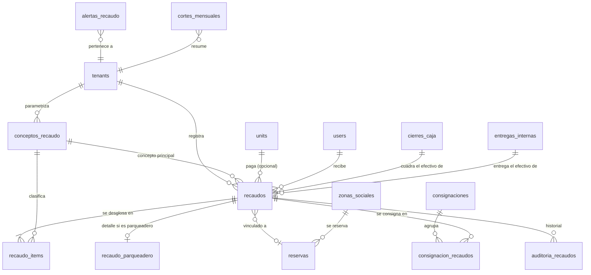
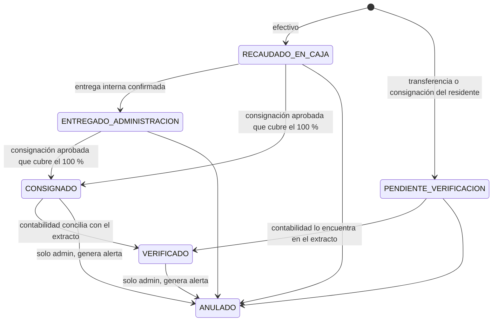

# Módulo de Recaudos y Control de Ingresos

Diseño del módulo de **ingresos extraordinarios** de la copropiedad (parqueadero de visitantes, alquiler de zonas sociales, aseo y otros), con control de caja, conciliación bancaria y trazabilidad completa.

Estado: **fases 1 a 4 implementadas** (base de datos, lógica, API y pantallas). Ver §5.

---

## 0. Cómo encaja en la plataforma actual

El módulo reutiliza lo que ya existe; no es una aplicación aparte.

| Ya existe | Cómo lo usa el módulo |
|---|---|
| Multi-tenant con RLS (`app_tenant_id()`, FK compuestas `(tenant_id, id)`) | Todas las tablas nuevas llevan `tenant_id`, FK compuestas y política `tenant_isolation` |
| Roles en `memberships.role` (`ADMIN`, `RESIDENTE`) | Se agregan `AUXILIAR`, `CONTABILIDAD` y `CONSEJO` al mismo enum |
| Migraciones SQL-first en `alembic/sql/` | Nueva migración `0003_recaudos` |
| Almacenamiento S3 con URL firmadas | Soportes de pago y soportes bancarios |
| Celery + beat, correo (Mailpit/Resend) | Alertas por correo, transferencias vencidas sin verificar y corte mensual automático |
| Next.js con la paleta sobria de oficina | Nuevas pantallas bajo `/[tenant]/recaudos` |

**Decisiones de adaptación:**

1. **Nombres de tablas en español**, como pide el requerimiento (`recaudos`, `cierres_caja`...). Son términos del dominio contable colombiano sin traducción limpia.
2. **Dinero en `numeric(14,2)`**, nunca `float`: evita errores de redondeo. Montos siempre `> 0`.
3. **Fechas con zona horaria** (`timestamptz`). Los cortes por día y mes se calculan en `America/Bogota`.
4. **Soportes: se guarda la clave del archivo (`soporte_key`), no una URL.** Las URL firmadas vencen a los 5 minutos; la API genera una nueva cada vez que alguien abre el soporte. En la API el campo se expone como `url_soporte`.
5. **La base de datos es la última línea de defensa.** Las reglas críticas (no borrar, transiciones de estado válidas, auditoría, justificación obligatoria) se imponen con constraints, triggers y RLS, no solo en el código de la API.

---

## 1. Modelo entidad-relación

### 1.1 Catálogos

**`conceptos_recaudo`**: tabla maestra; agregar un cobro nuevo no requiere tocar código.

| Campo | Tipo | Notas |
|---|---|---|
| id | uuid PK | |
| tenant_id | uuid FK → tenants | Cada copropiedad tiene sus propias tarifas |
| codigo | text | `PARQUEADERO`, `ASEO`, `ALQUILER_ZONA`, `OTROS`... Único por tenant; el código de la app se apoya en él, no en el nombre |
| nombre | text | Visible al usuario |
| descripcion | text NULL | |
| tarifa_base | numeric(14,2) NULL | `NULL` en cobros variables |
| tipo_cobro | enum `FIJO`, `POR_HORA`, `VARIABLE` | |
| fraccion_minutos | int NULL | Para `POR_HORA`: fracción de cobro (p. ej. 60) |
| requiere_reserva | bool | |
| requiere_vehiculo | bool | |
| activo | bool | Desactivar en vez de borrar |
| created_at, updated_at | timestamptz | |

Datos semilla por copropiedad: Parqueadero de visitantes (`POR_HORA`, `requiere_vehiculo`), Aseo de áreas sociales (`FIJO`), Alquiler de zonas sociales (`FIJO`, `requiere_reserva`) y Otros recaudos (`VARIABLE`).

**`zonas_sociales`** y **`reservas`**: registro mínimo para vincular los alquileres. La plataforma no tiene aún un módulo de reservas; este es su punto de partida.

| `zonas_sociales` | Tipo | | `reservas` | Tipo |
|---|---|---|---|---|
| id, tenant_id | uuid | | id, tenant_id | uuid |
| nombre | text (único por tenant) | | zona_id | uuid FK |
| tarifa_alquiler | numeric(14,2) NULL | | unidad_id | uuid FK → units NULL |
| tarifa_aseo | numeric(14,2) NULL | | solicitante | text |
| activo | bool | | fecha_evento | date |
| | | | hora_inicio, hora_fin | time |
| | | | estado | enum `SOLICITADA`, `CONFIRMADA`, `CANCELADA`, `REALIZADA` |

### 1.2 Recaudos

**`recaudos`**: cada ingreso individual.

| Campo | Tipo | Notas |
|---|---|---|
| id | uuid PK | |
| tenant_id | uuid FK | |
| consecutivo | bigint | **Único por tenant y sin saltos** (ver 1.6). Los anulados conservan su número |
| fecha_recaudo | timestamptz | |
| concepto_id | uuid FK → conceptos_recaudo | Concepto principal |
| valor_recibido | numeric(14,2) > 0 | Igual a la suma de sus `recaudo_items` (lo verifica un trigger diferido) |
| nombre_pagador | text | |
| identificacion_pagador | text NULL | |
| unidad_id | uuid FK → units NULL | Opcional: visitante externo |
| medio_pago | enum `EFECTIVO`, `TRANSFERENCIA`, `CONSIGNACION` | |
| estado | enum (ver 1.5) | |
| numero_comprobante | text NULL | Número del recibo entregado o de la transacción bancaria |
| soporte_key | text NULL | Archivo adjunto en S3 |
| observaciones | text NULL | |
| reserva_id | uuid FK → reservas NULL | Obligatorio si el concepto `requiere_reserva` |
| usuario_receptor_id | uuid FK → users | Quién recibió el dinero |
| cierre_id | uuid FK → cierres_caja NULL | Cierre que cuadró este efectivo |
| entrega_id | uuid FK → entregas_internas NULL | Entrega interna que lo trasladó |
| anulado_por_id, anulado_at, motivo_anulacion | | Obligatorios si `estado = ANULADO` (CHECK) |
| created_at, updated_at | timestamptz | |

**`recaudo_items`**: el desglose. Un alquiler se cobra en **una sola transacción** con dos líneas: *Valor alquiler* + *Valor aseo*. Los demás recaudos tienen una sola línea. Así los reportes por concepto suman líneas y nunca mezclan rubros.

| Campo | Tipo |
|---|---|
| id, tenant_id, recaudo_id | uuid |
| concepto_id | uuid FK → conceptos_recaudo |
| descripcion | text NULL |
| valor | numeric(14,2) > 0 |

**`recaudo_parqueadero`**: detalle 1:1, solo para parqueadero.

| Campo | Tipo | Notas |
|---|---|---|
| recaudo_id | uuid PK, FK | |
| tenant_id | uuid | |
| placa_vehiculo | text | Normalizada en mayúsculas sin espacios (`ABC123`); indexada para el buscador |
| hora_ingreso, hora_salida | timestamptz | `hora_salida > hora_ingreso` |
| minutos_totales | int **generado** | Calculado por la base de datos: no puede quedar inconsistente |
| tarifa_sugerida | numeric(14,2) | Calculada por la API con la tarifa y la fracción del concepto. El cobro final puede diferir (descuento, cortesía) y queda auditado |

### 1.3 Control de efectivo

**`cierres_caja`**: un cierre por usuario y turno. Cubre los recaudos en efectivo de ese usuario que aún no tienen cierre.

| Campo | Tipo | Notas |
|---|---|---|
| id, tenant_id | uuid | |
| consecutivo | bigint | Único por tenant |
| usuario_id | uuid FK → users | Responsable de la caja |
| inicio_turno, fin_turno | timestamptz | |
| saldo_inicial | numeric(14,2) | Base de caja o fondo de cambio |
| saldo_esperado_sistema | numeric(14,2) | `saldo_inicial` + suma del efectivo del turno. Lo calcula el servidor, nunca el cliente |
| valor_fisico_contado | numeric(14,2) | Lo que el usuario contó |
| diferencia | numeric(14,2) **generado** | contado − esperado |
| tipo_diferencia | **generado** | `CUADRADO`, `SOBRANTE`, `FALTANTE` |
| observacion_justificacion | text NULL | **CHECK: obligatoria si diferencia ≠ 0** |
| created_at | timestamptz | |

**`entregas_internas`**: traslado del efectivo de recepción a la administración o tesorería. Agrupa N recaudos; al confirmarla pasan a `ENTREGADO_ADMINISTRACION`.

| Campo | Tipo |
|---|---|
| id, tenant_id | uuid |
| consecutivo | bigint |
| entregado_por_id, recibido_por_id | uuid FK → users (distintos) |
| fecha_entrega | timestamptz |
| valor_total | numeric(14,2) (debe igualar la suma de los recaudos asociados) |
| estado | enum `PENDIENTE_CONFIRMACION`, `CONFIRMADA`, `RECHAZADA` |
| observaciones | text NULL |

### 1.4 Conciliación bancaria

**`consignaciones`**

| Campo | Tipo | Notas |
|---|---|---|
| id, tenant_id | uuid | |
| consecutivo | bigint | |
| fecha_consignacion | date | |
| banco_destino | text | |
| referencia_bancaria | text | Única por tenant y banco (evita registrar dos veces el mismo depósito) |
| valor_consignado | numeric(14,2) > 0 | |
| soporte_bancario_key | text | Comprobante del banco |
| usuario_consigna_id | uuid FK → users | |
| estado | enum `REGISTRADA`, `APROBADA`, `VERIFICADA`, `RECHAZADA` | |
| aprobada_por_id / aprobada_at, verificada_por_id / verificada_at | | |
| observaciones | text NULL | |

**`consignacion_recaudos`**: relación N:M **con valor aplicado**. Así se pueden agrupar muchos recaudos en una consignación y también **consignar un recaudo en partes**.

| Campo | Tipo | Notas |
|---|---|---|
| consignacion_id, recaudo_id | uuid (PK compuesta) | |
| tenant_id | uuid | |
| valor_aplicado | numeric(14,2) > 0 | La suma aplicada a un recaudo nunca supera su valor (trigger) |

El **saldo pendiente por consignar** de un recaudo es `valor_recibido − Σ valor_aplicado` en consignaciones no rechazadas. Pasa a `CONSIGNADO` cuando ese saldo llega a 0 **y** la consignación está aprobada.

### 1.5 Ciclo de vida del recaudo

Un trigger `BEFORE UPDATE` rechaza cualquier transición que no esté en este diagrama, aunque venga de un error del código. `ANULADO` es final.

### 1.6 Auditoría, alertas y consecutivos

**`auditoria_recaudos`**: la llena **un trigger de la base de datos** (no el código de la API), así ninguna ruta puede saltársela.

| Campo | Tipo | Notas |
|---|---|---|
| id | bigint identity | |
| tenant_id | uuid | |
| entidad | text | `recaudo`, `cierre_caja`, `entrega_interna`, `consignacion`, `concepto` |
| entidad_id | uuid | |
| recaudo_id | uuid NULL | Atajo para filtrar el historial de un recaudo |
| usuario_id | uuid | `app_user_id()` |
| accion | enum `CREACION`, `EDICION`, `CAMBIO_ESTADO`, `ANULACION` | |
| valores_anteriores, valores_nuevos | jsonb | Solo los campos que cambiaron |
| motivo | text NULL | La API lo pasa con `SET LOCAL app.motivo` |
| ip | inet NULL | |
| fecha_hora | timestamptz | |

Políticas: inserción solo vía trigger; **`UPDATE` y `DELETE` prohibidos para todos** (append-only, igual que `audit_logs`).

**`alertas_recaudo`**

| Campo | Tipo |
|---|---|
| id, tenant_id | uuid |
| tipo | enum `DIFERENCIA_CIERRE`, `DESCUADRE_CONSIGNACION`, `DESCUADRE_ENTREGA`, `TRANSFERENCIA_SIN_VERIFICAR`, `ANULACION_POSTERIOR` |
| severidad | enum `INFO`, `ADVERTENCIA`, `CRITICA` |
| entidad, entidad_id | text, uuid |
| mensaje | text |
| monto | numeric(14,2) NULL |
| estado | enum `ABIERTA`, `ATENDIDA` |
| atendida_por_id, atendida_at, resolucion | (resolución obligatoria al atender) |

**`cortes_mensuales`**: foto inmutable del mes, generada automáticamente: `periodo` (date, primer día del mes, único por tenant), `resumen` (jsonb con los totales), `pdf_key`, `xlsx_key` y `generado_at`.

**`secuencias`**: contador por tenant y tipo de documento (`recaudo`, `cierre`, `entrega`, `consignacion`). Se usa `UPDATE ... SET ultimo = ultimo + 1 RETURNING` dentro de la misma transacción del INSERT. Un `SERIAL` dejaría huecos en la numeración cuando una transacción falla, y los huecos en recibos son lo primero que objeta una auditoría.

### 1.7 Inmutabilidad: cómo se garantiza que nada se borre

1. `REVOKE DELETE ON recaudos, recaudo_items, consignacion_recaudos, cierres_caja, auditoria_recaudos FROM app_user`: el usuario de la app ni siquiera tiene el permiso.
2. Trigger `BEFORE DELETE` que lanza error, por si un rol con más privilegios lo intentara.
3. Un recaudo `VERIFICADO` o `ANULADO` no admite ediciones de montos (trigger). Las correcciones se hacen **anulando y registrando uno nuevo**.
4. Los totales "activos" excluyen `ANULADO`; los reportes de auditoría los muestran.

---

## 2. Roles y permisos

| Acción | Administrador | Auxiliar / Recepción | Contabilidad | Consejo |
|---|:-:|:-:|:-:|:-:|
| Conceptos y zonas: crear, editar, desactivar | Sí | No | No | No |
| Registrar recaudos y subir soportes | Sí | Sí | No | No |
| Editar datos descriptivos de un recaudo (pagador, unidad, comprobante, soporte, observaciones) | Sí, si no está verificado | Solo los suyos, el mismo día y antes del cierre | No | No |
| Anular recaudos | Sí | No | No | No |
| Cierre de caja | Sí | Sí (el suyo) | Lectura | No |
| Entregas internas | Confirmar/recibir | Entregar | Lectura | No |
| Registrar consignaciones | Sí | Sí | No | No |
| Aprobar consignaciones | Sí | No | Sí | No |
| Verificar (estado `VERIFICADO`) | Sí | No | Sí | No |
| Ver movimientos | Todos | Solo los suyos | Todos | No |
| Atender alertas | Sí | No | Lectura | No |
| Reportes y exportaciones | Todos | Sus movimientos y su caja | Todos | Dashboard y corte mensual |

Se imponen en dos capas:
- **API:** dependencias `require_roles(...)` en cada endpoint.
- **Base de datos:** políticas RLS por rol con una nueva función `app_role()`. Por ejemplo, el auxiliar solo puede leer filas con `usuario_receptor_id = app_user_id()`, y el consejo no tiene acceso a las tablas de detalle; lee los cortes mensuales.

Los roles nuevos ven los documentos del módulo documental como un residente (solo públicos), porque `app_is_admin()` sigue limitado a `ADMIN`.

---

## 3. API

Prefijo: `/api/v1/tenants/{tenant_id}/recaudos`, con el mismo patrón que `deadlines` y `quotes`. Los roles van entre corchetes.

### Conceptos y zonas
| Método y ruta | Descripción |
|---|---|
| `GET /conceptos` [todos menos Consejo] | Lista (filtro `activo`) |
| `POST /conceptos` · `PATCH /conceptos/{id}` [Admin] | Crear o editar; desactivar con `activo=false` |
| `GET /zonas` · `POST /zonas` · `PATCH /zonas/{id}` [Admin escribe] | Zonas sociales |
| `GET /reservas` · `POST /reservas` · `PATCH /reservas/{id}` [Admin, Auxiliar] | Registro de reservas |

### Recaudos
| Método y ruta | Descripción |
|---|---|
| `POST /soportes/upload-url` [Admin, Auxiliar] | URL firmada para subir un soporte (como en documentos) |
| `POST /` [Admin, Auxiliar] | Registrar. Valida campos dinámicos según el concepto; asigna consecutivo y estado inicial según el medio de pago |
| `POST /parqueadero/cotizar` [Admin, Auxiliar] | Dadas la hora de ingreso y la de salida, devuelve el tiempo y la tarifa sugerida (sin guardar) |
| `GET /` [Admin, Contabilidad, Auxiliar (los suyos)] | Buscador paginado. Filtros: `desde`, `hasta`, `mes`, `anio`, `concepto_id`, `medio_pago`, `estado`, `usuario_id`, `unidad_id`, `pagador`, `placa` |
| `GET /{id}` | Detalle con items, parqueadero, reserva, consignaciones y URL firmada del soporte |
| `PATCH /{id}` [Admin, Auxiliar con restricciones] | Editar campos permitidos; exige `motivo` |
| `POST /{id}/anular` [Admin] | Anular con `motivo` obligatorio |
| `POST /{id}/verificar` [Admin, Contabilidad] | Verificar una transferencia o consignación directa |
| `GET /{id}/auditoria` [Admin, Contabilidad] | Historial del recaudo |

### Caja
| Método y ruta | Descripción |
|---|---|
| `GET /caja/estado` [Admin, Auxiliar] | Vista previa del cierre: efectivo del turno, saldo esperado y recaudos incluidos |
| `POST /caja/cierres` [Admin, Auxiliar] | Ejecutar el cierre: `saldo_inicial`, `valor_fisico_contado` y `observacion_justificacion` si hay diferencia. Con diferencia, crea alerta y avisa por correo |
| `GET /caja/cierres` · `GET /caja/cierres/{id}` | Historial (el auxiliar ve solo los suyos) |
| `POST /entregas` [Auxiliar, Admin] | Crear una entrega interna con recaudos en caja |
| `POST /entregas/{id}/confirmar` · `/rechazar` [Admin] | Quien recibe confirma; si el valor no cuadra, crea alerta |
| `GET /entregas` | Historial |

### Conciliación
| Método y ruta | Descripción |
|---|---|
| `GET /consignaciones/pendientes` [Admin, Auxiliar] | Recaudos en efectivo con saldo por consignar |
| `POST /consignaciones` [Admin, Auxiliar] | Registrar: datos bancarios, soporte y `[{recaudo_id, valor_aplicado}]` |
| `POST /consignaciones/{id}/aprobar` [Admin, Contabilidad] | Aprueba; los recaudos cubiertos al 100 % pasan a `CONSIGNADO`. Si el valor consignado difiere de lo aplicado, crea alerta |
| `POST /consignaciones/{id}/verificar` [Admin, Contabilidad] | Conciliada con el extracto: los recaudos pasan a `VERIFICADO` |
| `POST /consignaciones/{id}/rechazar` [Admin, Contabilidad] | Libera los saldos aplicados |
| `GET /consignaciones` · `GET /consignaciones/{id}` | Historial y detalle |

### Dashboard, alertas y reportes
| Método y ruta | Descripción |
|---|---|
| `GET /dashboard?mes=&anio=` [Admin, Contabilidad, Consejo] | KPIs, distribución por concepto, por medio de pago, efectivo pendiente en tiempo real y serie diaria |
| `GET /alertas?estado=` · `POST /alertas/{id}/atender` [Admin atiende] | Feed y resolución |
| `GET /reportes/{tipo}?desde=&hasta=&formato=json\|xlsx\|pdf` | `general`, `parqueadero`, `zonas`, `aseo`, `caja`, `auditoria` |
| `GET /cortes` · `GET /cortes/{periodo}` [Admin, Contabilidad, Consejo] | Cortes mensuales con descarga en PDF y Excel |

### Tareas en segundo plano (Celery beat)
| Tarea | Cuándo | Qué hace |
|---|---|---|
| `recaudos.transferencias_sin_verificar` | Diario, 8:00 | Alerta por transferencias con más de N días (configurable, 3 por defecto) en `PENDIENTE_VERIFICACION` |
| `recaudos.corte_mensual` | Día 1, 6:00 | Genera el corte del mes anterior (resumen, PDF y Excel) y lo envía por correo a Administración y Consejo |
| `recaudos.notificar_alerta` | Al crear una alerta | Correo al administrador |

---

## 4. Stack e implementación

Se usa el **stack actual**, sin piezas nuevas de infraestructura:

| Capa | Tecnología | Nuevo en el proyecto |
|---|---|---|
| Base de datos | PostgreSQL: migración SQL `0003_recaudos` con enums, constraints, triggers y RLS | — |
| Backend | FastAPI + SQLAlchemy 2 + Pydantic v2; servicio de dominio `app/services/recaudos/` con la máquina de estados | — |
| Excel | **openpyxl** | Sí, una dependencia de Python |
| PDF | **PyMuPDF** (ya instalado; su API `Story` maqueta HTML a PDF) | — |
| Tareas | Celery beat | — |
| Frontend | Next.js + shadcn/ui; gráficos propios con HTML y CSS (al implementar se descartó Recharts: los tres gráficos son de una sola serie y no justificaban una dependencia) | — |

**Fases de implementación** (cada una con tests y verificable por separado):

1. **Base de datos y dominio:** migración 0003, roles nuevos, semillas, modelos y servicio de recaudos (registro, campos dinámicos, máquina de estados, anulación y auditoría). Tests de reglas: transiciones inválidas, borrado prohibido, aislamiento entre tenants y permisos por rol.
2. **Caja y conciliación:** cierres, entregas internas, consignaciones parciales y alertas con correo.
3. **API completa** y usuarios demo de cada rol.
4. **Frontend:** registro rápido de recaudos (pensado para recepción), buscador con filtros, caja, conciliación y dashboard.
5. **Reportes** en Excel y PDF y **corte mensual** automático.

**Fuera de alcance por ahora** (posibles extensiones):
- Cuotas ordinarias de administración y cartera.
- Lectura automática de extractos bancarios.
- Facturación electrónica DIAN.
- Pagos en línea (PSE).

---

## 5. Estado de implementación

### Fase 1: base de datos y dominio (hecha)

| Pieza | Archivo |
|---|---|
| Migración (14 tablas, enums, triggers, RLS, semillas) | `apps/api/alembic/sql/0003_recaudos.up.sql` (+ `.down.sql`) |
| Modelos SQLAlchemy | `apps/api/app/models/recaudo.py` |
| Esquemas de entrada | `apps/api/app/schemas/recaudos.py` |
| Reglas puras (permisos, máquina de estados, tarifas) | `apps/api/app/services/recaudos/dominio.py` |
| Casos de uso (registrar, editar, anular, verificar, historial, cotizar) | `apps/api/app/services/recaudos/service.py` |
| Tests | `tests/unit/test_recaudos_dominio.py`, `tests/integration/test_recaudos_db.py`, `tests/integration/test_recaudos_service.py` |

Decisión tomada al implementar: **el dinero de un recaudo no se edita nunca**. Concepto, valor, medio de pago, fecha, receptor, desglose y datos del parqueadero son inmutables desde su registro, lo impone un trigger. Un error en esos campos se corrige **anulando y registrando de nuevo**, y así queda rastro de ambos. Solo se editan los datos descriptivos, y siempre con motivo.

Integración con lo existente:
- La restauración nocturna de la demo incluye las tablas nuevas y desactiva los triggers mientras restaura.
- `seed` crea los conceptos iniciales.
- El buscador reconoce los roles nuevos.

### Fase 2: caja, entregas, conciliación y alertas (hecha)

| Pieza | Archivo |
|---|---|
| Vista previa y cierre de caja; entregas internas (crear, confirmar, rechazar) | `apps/api/app/services/recaudos/caja.py` |
| Consignaciones parciales: registrar, aprobar, verificar, rechazar y efectivo pendiente | `apps/api/app/services/recaudos/conciliacion.py` |
| Alertas: crear, listar, atender y transferencias sin verificar | `apps/api/app/services/recaudos/alertas.py` |
| Correo de alertas y tarea diaria (8:00) | `apps/api/app/workers/tasks/recaudos.py`, `notifications/email.py` |
| Tests | `tests/integration/test_recaudos_caja.py` |

Reglas adicionales tomadas al implementar:

- **Todo efectivo pasa por un cierre de caja** antes de entregarse o consignarse. Así cada peso queda contado por alguien con nombre propio.
- **La entrega interna la confirma solo quien recibe**, contando el dinero. Si el valor no coincide, debe explicarlo y se genera una alerta.
- **Una consignación solo se rechaza antes de aprobarse.** Después, los recaudos ya están en `CONSIGNADO` y la máquina de estados no permite devolverlos.
- **El auxiliar crea alertas pero no las ve.** Su cierre con faltante avisa a la administración sin que él pueda ocultar el aviso.
- **Los correos de alertas se envían después del commit** y marcan `notificada_at`: un reintento nunca duplica el correo.
- Días para alertar transferencias sin verificar: `tenants.settings.recaudos_dias_verificacion`, 3 por defecto.

### Fase 3: API y datos de demostración (hecha)

| Pieza | Archivo |
|---|---|
| Catálogos, soportes, buscador y recaudos | `apps/api/app/api/v1/recaudos.py` |
| Caja, entregas y consignaciones | `apps/api/app/api/v1/recaudos_caja.py` |
| Dashboard y alertas | `apps/api/app/api/v1/recaudos_panel.py` |
| Consultas de lectura (buscador con filtros, detalles, listados) | `apps/api/app/services/recaudos/consultas.py`, `catalogos.py` |
| Traducción de errores de dominio y de PostgreSQL a HTTP | `apps/api/app/api/errores.py` |
| Resumen para el dashboard (función `resumen_recaudos`) | migración 0003, §11b |
| Movimientos de demostración (~6 semanas) | `apps/api/app/scripts/demo_recaudos.py` (`python -m app.scripts.demo recaudos`) |
| Tests por HTTP | `tests/integration/test_recaudos_api.py` |

**Usuarios demo** (contraseña `Demo1234!`): `recepcion@lospinos.demo` (Auxiliar), `contabilidad@lospinos.demo` y `consejo@lospinos.demo`.

Decisiones de esta fase:

- **El Consejo ve el dashboard sin ver el detalle.** La función `resumen_recaudos` (SECURITY DEFINER) entrega solo totales, comprueba el rol y filtra por copropiedad. RLS le sigue negando las tablas de recaudos.
- **Errores con sentido.** Una regla frenada por la base de datos (trigger, CHECK o RLS) responde 403 o 409 con el mensaje del trigger, nunca un 500.
- **Soportes aislados por copropiedad.** Un recaudo solo puede referenciar archivos subidos en la carpeta de su propia copropiedad. La limpieza nocturna de la demo borra los soportes que suban los visitantes.
- **Orden de rutas.** Las rutas fijas (`/caja`, `/entregas`, `/alertas`...) se registran antes que `/{recaudo_id}`.

### Fase 4: pantallas (hecha)

Sección **Recaudos** en el menú lateral, con los ítems de cada rol:

| Pantalla | Ruta | Roles | Qué hace |
|---|---|---|---|
| Resumen | `/recaudos` | Admin, Contabilidad, Consejo | KPIs del mes, recaudo diario, por concepto, por medio, estado del dinero y alertas. Recepción es redirigida a Registrar |
| Registrar | `/recaudos/nuevo` | Admin, Recepción | Cobro rápido con campos según el concepto: tarifa del parqueadero en vivo y alquiler con reserva y desglose |
| Movimientos | `/recaudos/movimientos` | Admin, Contabilidad, Recepción | Buscador con filtros en la URL; detalle con acciones e historial de auditoría |
| Caja | `/recaudos/caja` | Admin, Recepción | Turno, cierre con diferencia en vivo, entregas internas, historial de arqueos |
| Conciliación | `/recaudos/conciliacion` | Admin, Contabilidad, Recepción | Efectivo por consignar, consignaciones parciales, aprobar, verificar y rechazar |
| Alertas | `/recaudos/alertas` | Admin, Contabilidad | Feed de alertas; la administración las atiende con resolución escrita |
| Configuración | `/recaudos/configuracion` | Admin | Conceptos, tarifas y zonas sociales |

Componentes en `apps/web/src/components/recaudos/`; tipos, etiquetas y permisos de interfaz en `apps/web/src/lib/recaudos.ts`. Lo probé de punta a punta con los cuatro roles en el navegador: registro, cierre con faltante, entrega, consignación, aprobación y verificación, sin errores de JavaScript.

Pendiente: fase 5 (reportes en Excel y PDF, corte mensual automático).
