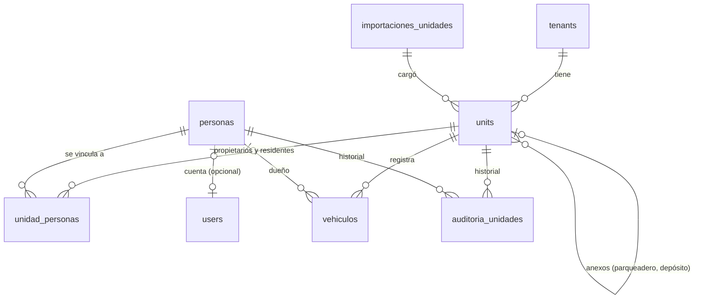

# Módulo de Unidades, Copropietarios y Residentes

Diseño del tercer módulo: el **censo de la copropiedad**. Registra las unidades privadas (apartamentos, casas, locales, parqueaderos y depósitos), sus **coeficientes de copropiedad**, quién es **propietario**, quién **vive** en cada una, sus **vehículos**, y permite **importarlo todo desde Excel**.

Estado: **fase 1 hecha** (base de datos y dominio). Ver §7.

---

## 0. Cómo encaja en la plataforma

Hoy la tabla `units` existe desde la migración 0001, pero solo tiene torre, número y coeficiente, y se llena por semilla. Recaudos ya la usa (pagador por unidad, reservas de zonas sociales) y `memberships.unit_id` enlaza al residente con su apartamento. Este módulo **amplía `units` en vez de crear otra tabla**, así nada de lo existente se rompe.

| Ya existe | Cómo lo usa el módulo |
|---|---|
| `units` (torre, número, coeficiente) y FK compuestas `(tenant_id, id)` | Se amplía con tipo, área, matrícula inmobiliaria, estado de ocupación y unidad principal (para anexos) |
| `memberships` con rol y `unit_id` | Una persona del directorio puede tener cuenta de usuario (`personas.user_id`). Al vincularla como residente de una unidad, `memberships.unit_id` se mantiene sincronizado por trigger |
| Recaudos: pagador, unidad, placa | Al elegir la unidad en "Registrar recaudo" se sugiere el nombre y documento del propietario o residente. La placa del parqueadero se compara con los vehículos registrados (residente vs. visitante) |
| Auditoría por trigger, nada se borra, exportar Excel/PDF | Mismos patrones: auditoría de cambios, unidades y personas se **desactivan**, los vínculos se **cierran con fecha** (historial de propietarios y arrendatarios) |

**Decisiones de adaptación:**

1. **Persona ≠ usuario.** La mayoría de propietarios nunca entrará a la plataforma, pero la administración necesita su nombre, documento y teléfono. `personas` es el directorio; `users` son solo las cuentas. Una persona puede tener cuenta o no.
2. **El vínculo persona–unidad tiene historia.** Cuando se vende un apartamento o se va un arrendatario no se borra nada: el vínculo se cierra con `fecha_fin`. Así se puede responder "¿quién era el propietario en marzo de 2025?" (útil para cartera y asambleas).
3. **Anexos como unidades.** En muchas copropiedades el parqueadero y el depósito son unidades privadas con matrícula y coeficiente propios. Se modelan como unidades con `unidad_principal_id` apuntando al apartamento. Si en el conjunto los parqueaderos son comunales, simplemente no se registran.
4. **Coeficientes validados, no bloqueados.** La Ley 675 exige que sumen 100 %. La base no lo impide (sería imposible cargar unidad por unidad), pero el módulo muestra la suma en todo momento y la importación advierte si no cuadra.
5. **Datos personales (Ley 1581 de 2012).** Se guarda la fecha de autorización de tratamiento de datos de cada persona. Recepción ve nombre, unidad y teléfono, pero no documento ni correo; los residentes solo ven su propia unidad.

---

## 1. Modelo entidad-relación

### 1.1 `units` (ampliada)

| Campo | Tipo | Notas |
|---|---|---|
| `id`, `tenant_id`, `tower`, `number`, `coefficient` | existentes | `coefficient numeric(7,4)` en porcentaje (p. ej. `0.8532`) |
| `tipo` | enum `tipo_unidad` | `APARTAMENTO`, `CASA`, `LOCAL`, `OFICINA`, `PARQUEADERO`, `DEPOSITO`, `OTRO`. Por defecto `APARTAMENTO` |
| `unidad_principal_id` | uuid null | FK compuesta a `units`. Solo para anexos; sin ciclos (CHECK distinto de `id` + trigger) |
| `area_m2` | numeric(8,2) null | Área privada construida |
| `matricula_inmobiliaria` | text null | Única por copropiedad si se informa |
| `ocupacion` | enum `ocupacion_unidad` | `PROPIETARIO`, `ARRENDADA`, `DESOCUPADA`, `SIN_INFORMACION`. Se sugiere a partir de los vínculos vigentes, pero el administrador la puede fijar |
| `observaciones` | text null | |
| `activa` | boolean | Desactivar en vez de borrar (unidades fusionadas o mal creadas) |
| `created_at`, `updated_at` | timestamptz | |

`DELETE` prohibido por trigger (ya hay recaudos que la referencian).

### 1.2 `personas` (directorio)

| Campo | Tipo | Notas |
|---|---|---|
| `id`, `tenant_id` | uuid | |
| `tipo_documento` | enum | `CC`, `CE`, `NIT`, `PASAPORTE`, `PPT`, `TI` |
| `numero_documento` | text null | Único por copropiedad junto con el tipo |
| `nombre_completo` | text | |
| `email` | citext null | |
| `telefono`, `telefono_alterno` | text null | |
| `user_id` | uuid null | Cuenta en la plataforma (única por copropiedad) |
| `autoriza_datos_at` | timestamptz null | Autorización Ley 1581 |
| `notas` | text null | |
| `activa` | boolean | |
| `created_at`, `updated_at` | timestamptz | |

Búsqueda por nombre sin tildes (índice `es_unaccent` / trigram).

### 1.3 `unidad_personas` (vínculos con historia)

| Campo | Tipo | Notas |
|---|---|---|
| `id`, `tenant_id`, `unidad_id`, `persona_id` | uuid | FK compuestas |
| `relacion` | enum `relacion_unidad` | `PROPIETARIO`, `ARRENDATARIO`, `RESIDENTE` (familiar u ocupante), `AUTORIZADO` (puede recoger paquetes, pagar) |
| `porcentaje_propiedad` | numeric(5,2) null | Copropietarios de una misma unidad; si se informa, los vigentes deben sumar ≤ 100 |
| `es_contacto_principal` | boolean | Máximo uno vigente por unidad (índice único parcial) |
| `responsable_pago` | boolean | A quién se le cobra la cuota (lo usará la cartera). Máximo uno vigente por unidad; por defecto, el primer propietario |
| `reside` | boolean | Un propietario puede no vivir allí |
| `fecha_inicio` | date | |
| `fecha_fin` | date null | `NULL` = vigente. Cerrar en vez de borrar |
| `motivo_cierre` | text null | Venta, fin del arriendo, mudanza |
| `created_at` | timestamptz | |

Restricción: la misma persona no puede tener dos vínculos vigentes con la misma relación en la misma unidad (índice único parcial `WHERE fecha_fin IS NULL`).

### 1.4 `vehiculos`

| Campo | Tipo | Notas |
|---|---|---|
| `id`, `tenant_id`, `unidad_id`, `persona_id` (null) | uuid | |
| `placa` | text | Mismo formato que recaudos (`^[A-Z0-9]{5,7}$`), única vigente por copropiedad |
| `tipo` | enum | `CARRO`, `MOTO`, `BICICLETA`, `OTRO` |
| `marca`, `color` | text null | |
| `activo` | boolean | |

### 1.5 `importaciones_unidades` y `auditoria_unidades`

- **`importaciones_unidades`**: quién importó, cuándo, nombre del archivo, filas leídas, creadas, actualizadas y con error, y el detalle de errores (jsonb). Sirve de bitácora.
- **`auditoria_unidades`**: escrita por trigger sobre `units`, `personas`, `unidad_personas` y `vehiculos` (acción, valores anteriores y nuevos, usuario). Mismo patrón que `auditoria_recaudos`.

---

## 2. Importación desde Excel

El caso real es "el administrador anterior me dejó un Excel". El flujo:

1. **Descargar plantilla** `.xlsx` con dos hojas, `Unidades` y `Personas`, encabezados, ejemplos y listas desplegables (tipo de unidad, relación, tipo de documento).
2. **Subir el archivo → vista previa (no guarda nada).** La API valida fila por fila y responde: unidades nuevas, unidades que cambian (con el antes y después), personas nuevas, vínculos, y errores con hoja, fila y mensaje ("Fila 14: el coeficiente '0,85%' no es un número", "Fila 22: la unidad principal T1-PQ-05 no existe"). Muestra la **suma de coeficientes** resultante.
3. **Confirmar** → se aplica todo en **una sola transacción**: si algo falla, no queda nada a medias. Se registra en `importaciones_unidades`.

Reglas: la clave de la unidad es `(torre, número)`; la de la persona, `(tipo, número de documento)` o, si no tiene documento, nombre + unidad. Reimportar el mismo archivo no duplica nada (es idempotente). La importación **nunca desactiva** lo que no viene en el archivo: solo crea y actualiza. Acepta números con coma decimal y porcentajes ("0,8532 %").

---

## 3. Roles y permisos

| Acción | ADMIN | AUXILIAR | CONTABILIDAD | CONSEJO | MANTENIMIENTO | RESIDENTE |
|---|---|---|---|---|---|---|
| Ver unidades (torre, número, tipo) | ✔ | ✔ | ✔ | ✔ | ✔ | Solo la suya |
| Ver coeficientes, áreas, matrícula | ✔ | | ✔ | ✔ | | Solo la suya |
| Ver directorio (nombre, teléfono, unidad) | ✔ | ✔ | ✔ | | | Su unidad |
| Ver documento, correo y notas | ✔ | | ✔ | | | Sus propios datos |
| Ver vehículos | ✔ | ✔ | | | | Los suyos |
| Crear y editar unidades, personas, vínculos, vehículos | ✔ | | | | | |
| Importar desde Excel | ✔ | | | | | |
| Exportar censo (Excel/PDF) | ✔ | | ✔ | ✔ (sin datos de contacto) | | |

Se aplica en dos capas, como en los otros módulos: RLS en la base (por rol y, para el residente, por unidad vinculada) y columnas filtradas en la capa de consultas.

---

## 4. API (`/api/v1/unidades`, `/api/v1/personas`)

| Método y ruta | Uso |
|---|---|
| `GET /unidades` | Lista con filtros (torre, tipo, ocupación, texto, activas) y paginación. Incluye propietario y residente principal |
| `GET /unidades/resumen` | Totales por tipo y ocupación, suma de coeficientes, unidades sin propietario |
| `POST /unidades` · `PATCH /unidades/{id}` · `POST /unidades/{id}/desactivar` | Gestión |
| `GET /unidades/{id}` | Ficha: datos, anexos, vínculos vigentes e históricos, vehículos, últimos recaudos |
| `POST /unidades/{id}/vinculos` · `POST /vinculos/{id}/cerrar` | Vincular persona (existente o nueva) y cerrar vínculo |
| `GET/POST/PATCH /personas` · `GET /personas/{id}` | Directorio y ficha de persona con sus unidades |
| `GET/POST/PATCH /unidades/{id}/vehiculos` · `GET /vehiculos?placa=` | Vehículos; la búsqueda por placa la usa recaudos |
| `GET /unidades/importar/plantilla` | Plantilla `.xlsx` |
| `POST /unidades/importar/previa` · `POST /unidades/importar/confirmar` | Importación en dos pasos (la confirmación reenvía el archivo con el hash de la vista previa, para garantizar que se aplica exactamente lo revisado) |
| `GET /unidades/exportar?formato=xlsx|pdf` | Censo |
| `GET /mi-unidad` | Para el residente: su unidad, sus datos y vehículos |

---

## 5. Pantallas

Con el estilo sobrio de los otros módulos (azul marino, grises):

1. **Unidades**: tabla con buscador y filtros, chips de ocupación, y en la parte superior tarjetas con totales y la suma de coeficientes (verde si es 100 %, ámbar si no).
2. **Ficha de la unidad** (panel lateral): datos, anexos, personas vigentes con su relación, historial de propietarios y arrendatarios, vehículos y accesos rápidos ("Registrar recaudo para esta unidad").
3. **Directorio de personas**: búsqueda por nombre, documento o teléfono, con las unidades de cada uno.
4. **Importar desde Excel**: asistente de 3 pasos (plantilla → vista previa con errores resaltados → confirmar).
5. **Mi unidad** (residente): sus datos, quién figura en la unidad y sus vehículos.
6. **Integración con Recaudos**: al elegir la unidad se autocompleta el pagador; en parqueadero, la placa se marca como "residente de T2-301" o "visitante".

---

## 6. Plan de implementación

| Fase | Contenido |
|---|---|
| **1. Base de datos y dominio** | Migración 0007 (ampliar `units`, 5 tablas nuevas, enums, triggers de auditoría, prohibición de DELETE, sincronización de `memberships.unit_id`, RLS por rol), modelos, servicios y pruebas |
| **2. API, importación y demo** | Endpoints, importador Excel con vista previa, exportación, datos de demostración (Los Pinos con ~120 unidades, anexos, propietarios y arrendatarios) y pruebas |
| **3. Pantallas e integración** | Las 5 pantallas, autocompletado en Recaudos, verificación E2E con Playwright y capturas |

Fuera de alcance (posibles módulos siguientes): **invitaciones de usuarios** (crear la cuenta de una persona del directorio desde su ficha), **cartera de cuotas ordinarias** (usaría coeficientes y propietarios) y **asambleas con quórum por coeficiente**.

---

## 7. Estado de implementación

### Fase 1: base de datos y dominio (hecha)

- **Migración 0007** (`alembic/sql/0007_unidades.up.sql`): amplía `units` (tipo, anexo, área, matrícula, ocupación, activa) y crea `personas`, `unidad_personas`, `vehiculos`, `importaciones_unidades` y `auditoria_unidades`.
- **Reglas en la base:** `DELETE` prohibido en las seis tablas; anexos de un solo nivel; un vínculo cerrado no se modifica y al cerrarse deja de ser contacto y responsable de pago; un contacto principal y un responsable de pago vigentes por unidad; placa única entre vehículos activos; auditoría automática con motivo.
- **`memberships.unit_id` derivado:** al vincular o desvincular a una persona con cuenta, un trigger recalcula la unidad que ve el residente (prioridad: donde reside, luego propietario, luego arrendatario).
- **RLS por rol:** `app_unidades_propias()` da al residente su unidad y sus anexos. Mantenimiento ve unidades pero no el directorio, recepción no ve la auditoría y contabilidad no ve los vehículos.
- **Código:** `app/models/unidad.py`, `app/schemas/unidades.py`, `app/services/unidades/dominio.py` (normalización de cédulas, placas, teléfonos, torres y coeficientes en formato colombiano) y `gestion.py` (casos de uso).
- **Pruebas:** 49 unitarias y 16 de integración (261 en total, todas en verde).

**Nota para producción:** las funciones `SECURITY DEFINER` (`app_unidades_propias`, `sincronizar_unidad_membership` y las de los otros módulos) asumen que el dueño del esquema ignora la RLS. En Docker lo hace porque es superusuario. En una base administrada, el rol dueño necesita `BYPASSRLS`.
